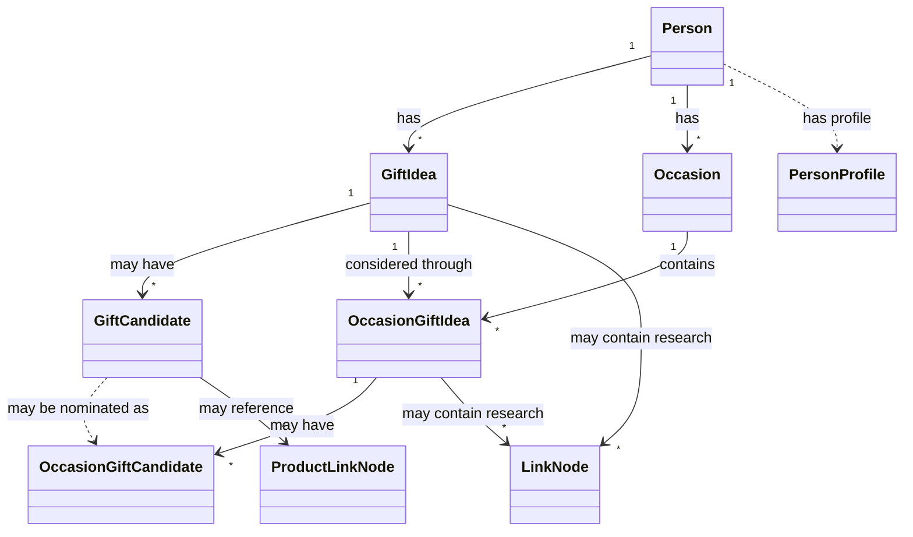
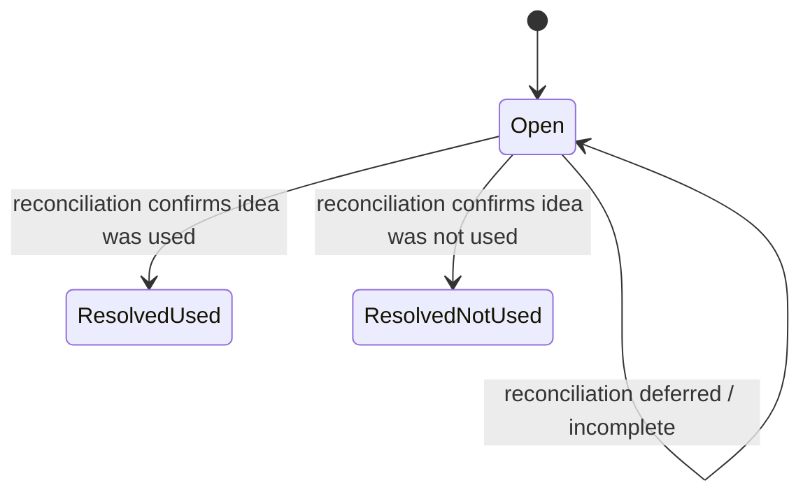

# GiftPipe Domain Model

## 1. Purpose and scope

This document captures the conceptual and behavioral domain model established so far for GiftPipe.

It focuses on domain concepts, relationships, rules, lifecycle behavior, and business processes that have emerged from product discovery. It deliberately avoids prescribing database schemas, ORM mappings, API shapes, UI components, framework choices, or persistence strategies.

The canonical vocabulary for GiftPipe belongs in `../product/glossary.md`. This document uses those terms to explain how the concepts behave together. Future `../product/requirements.md` documentation should describe externally observable behavior and acceptance criteria that arise from this model.

Where discovery has not yet produced a firm conclusion, the model explicitly marks concepts and relationships as **Tentative** or **Unresolved** rather than silently completing the design.

---

## 2. Domain overview

GiftPipe helps a user capture gift-related ideas for people, research those ideas over time, associate them with occasions, receive reminders, and later reconcile what was actually given.

The core long-lived concept is the **GiftIdea**. A GiftIdea belongs to a Person and may be broad or concrete. Its specificity does not determine whether it is a GiftIdea or a GiftCandidate.

A **GiftCandidate** is a concrete option represented while researching an existing GiftIdea. Candidates can remain reusable across occasions.

An **OccasionGiftIdea** records that a GiftIdea is being considered for a particular Occasion. This association has its own business meaning: it can hold occasion-specific research, participate in reminders, and later be reconciled to an outcome.

An **OccasionGiftCandidate** represents a concrete option that has been nominated into a specific OccasionGiftIdea context. Multiple OccasionGiftCandidates may be relevant, selected, or eventually given for the same occasion because multiple gifts are valid.

Research may occur at two scopes:

- **General GiftIdea research**, which is reusable across occasions.
- **Occasion-specific research**, which applies only to one OccasionGiftIdea.

GiftPipe preserves raw research history, including rejected options, because those decisions are useful context later. Derived summaries may be used for AI context, but the preserved research history remains authoritative.

After an occasion, **Reconciliation** asks the user what was actually given. Reconciliation can resolve an OccasionGiftIdea even when no concrete candidate was ever captured. It can also capture previously unknown gifts so gifting history remains useful.

GiftPipe's AI is intentionally **bounded** to explicit gift-related actions. AI may help enhance ideas, generate candidates, compare options, summarize research, and suggest gifts, but it does not replace the domain model or silently redefine user-entered profile data.

---

## 3. Domain concept inventory

| Concept | Classification | Responsibility | Status |
|---|---|---|---|
| Person | Entity | Represents a gift recipient managed by the user | Confirmed |
| PersonProfile | Unclassified | Holds user-maintained recipient context relevant to gifting | Confirmed definition; classification unresolved |
| Occasion | Entity | Represents a recurring or one-off event for which gifts may be considered | Confirmed |
| GiftIdea | Entity | Represents a durable, occasion-independent gifting idea for a Person | Confirmed |
| GiftIdea Specificity | Value Object / Attribute concept | Describes how broad or concrete a GiftIdea is without changing its structural role | Confirmed meaning; classification tentative |
| GiftCandidate | Entity or owned concept | Represents a concrete option within GiftIdea research | Confirmed meaning; identity classification unresolved |
| OccasionGiftIdea | Association with domain behavior | Represents a GiftIdea considered for one Occasion and later reconciled | Confirmed |
| OccasionGiftCandidate | Association or occasion-scoped candidate concept | Represents a candidate relevant to one OccasionGiftIdea | Confirmed meaning; identity model unresolved |
| Candidate Nomination | Domain Operation | Makes a GiftCandidate relevant to an OccasionGiftIdea | Confirmed |
| Research Node | Unclassified | Represents one unit of hierarchical research | Tentative |
| Research Tree | Unclassified | Organizes research artifacts hierarchically | Confirmed concept; implementation shape unresolved |
| General GiftIdea Research | Unclassified | Preserves reusable research for a GiftIdea | Confirmed |
| Occasion-Specific Research | Unclassified | Preserves research relevant only to one OccasionGiftIdea | Confirmed |
| Research Thread | Unclassified | Proposed container for a coherent body of research | Tentative |
| LinkNode | Unclassified | Represents supporting reference material | Confirmed |
| ProductLinkNode | Unclassified | Represents a user-identified product link | Confirmed |
| Raw Research History | Unclassified | Preserves complete research history, including rejected material | Confirmed |
| Current Research State | Unclassified | Represents the presently relevant derived research state | Confirmed |
| Research Summary | Unclassified | Represents a derived compact summary of research | Tentative |
| Reconciliation | Domain Process | Resolves what actually happened after an Occasion | Confirmed |
| Gift History | Unclassified | Represents accumulated gifting outcomes over time | Confirmed |
| Gift Success Feedback | Value Object / Outcome concept | Records optional feedback about how a gift was received | Confirmed meaning; classification unresolved |
| Occasion Outcome | Value Object / Lifecycle concept | Represents the resolved result of an OccasionGiftIdea | Tentative vocabulary |
| Bounded AI | Domain Service concept | Provides explicit gift-related AI capabilities | Confirmed concept; classification tentative |
| AI Action | Domain Service operation | Performs one bounded AI task | Confirmed domain meaning |
| AI Research Output | Unclassified | Persists useful AI-generated research artifacts | Confirmed |

The table distinguishes domain meaning from architectural classification. Several concepts are well defined semantically but have not yet been classified as entities, value objects, aggregate members, or services.

---

## 4. Entities and value objects

### 4.1 Person

**Purpose:**  
Represents the recipient for whom the user captures gift ideas, tracks occasions, performs research, and records gifting history.

**Identity:**  
A Person is conceptually distinct from other recipients managed by the same GiftPipe user. The exact identity rules are not yet defined.

**Responsibilities:**

- Acts as the owner/context for GiftIdeas.
- Acts as the recipient for Occasions.
- Provides the recipient context used during gifting decisions.

**Relationships:**

- Has a PersonProfile.
- Has GiftIdeas.
- Has Occasions.
- Accumulates Gift History through resolved occasion activity.

**Lifecycle:**  
Creation and removal semantics have not yet been specified in detail.

**Invariants:**

- A GiftIdea must be associated with a Person.
- A PersonProfile must not be silently rewritten from gift outcomes or AI inference.

**Status:** Confirmed.

---

### 4.2 PersonProfile

**Purpose:**  
Stores user-maintained information about a Person that is relevant to gifting, including structured and free-form context.

**Identity:**  
Whether PersonProfile has identity independent of Person is unresolved.

**Responsibilities:**

- Preserve recipient facts and preferences explicitly maintained by the user.
- Provide context for AI-assisted gifting.

**Relationships:**  
Belongs to a Person.

**Lifecycle:**  
Initially, only the user changes the profile. AI or outcome-derived patterns may inform suggestions but must not silently modify it.

**Invariants:**

- Gift outcomes do not automatically mutate PersonProfile.
- AI inferences do not automatically become profile truth.

**Status:** Confirmed definition; classification unresolved.

---

### 4.3 Occasion

**Purpose:**  
Represents an event for which gifts may be considered.

**Identity:**  
An Occasion is conceptually distinct by the event it represents for a Person. Exact identity rules for recurring occurrences versus occasion definitions remain unspecified.

**Responsibilities:**

- Provide temporal context for gift planning.
- Serve as the occasion side of OccasionGiftIdea associations.
- Participate in reminders and post-occasion reconciliation.

**Relationships:**

- Associated with a Person.
- Has zero or more OccasionGiftIdeas.

**Lifecycle:**  
Occasions may be recurring or one-off. Exact recurrence semantics are deferred.

**Invariants:**

- Multiple gifts may be given for one Occasion.
- Multiple OccasionGiftIdeas may be considered for one Occasion.

**Status:** Confirmed.

---

### 4.4 GiftIdea

**Purpose:**  
Represents a durable gifting idea, topic, theme, or concrete gift concept for a Person.

**Identity:**  
A GiftIdea remains the same conceptual idea across multiple occasions unless the user intentionally creates a distinct new idea. The exact identity rule is user/domain-defined rather than inferred from textual specificity.

**Responsibilities:**

- Preserve the user's durable gifting intent.
- Own or contextualize general research.
- Serve as the durable idea referenced by OccasionGiftIdeas.
- Remain available across multiple occasions unless archived.

**Relationships:**

- Belongs to one Person.
- May have zero or more GiftCandidates.
- May have general research.
- May participate in zero or more OccasionGiftIdeas.

**Lifecycle:**

- Created through manual capture, including vague or concrete text.
- May accumulate research over time.
- May be associated with occasions.
- May remain useful after being given or not given.
- May eventually be archived.

**Invariants:**

- A GiftIdea can exist independently of an Occasion.
- A GiftIdea may be captured with only its Person assigned and no idea content; a generated placeholder title does not imply user-entered gifting intent.
- A GiftIdea can be arbitrarily vague or concrete.
- Specificity does not turn a GiftIdea into a GiftCandidate.
- A GiftIdea may resolve as used for an Occasion even if no GiftCandidate exists.
- Being given once does not automatically archive the GiftIdea.

**Status:** Confirmed.

---

### 4.5 GiftIdea Specificity

**Purpose:**  
Describes how broad or concrete the wording or intent of a GiftIdea is.

**Identity:**  
Not independently identified.

**Responsibilities:**  
Clarifies that phrases such as "Whisky", "Japanese whisky", "Nikka From the Barrel", or "Metallica tickets" can all validly represent GiftIdeas.

**Relationships:**  
Describes GiftIdea content but does not define Candidate status.

**Lifecycle:**  
A GiftIdea may become more refined through research, but no explicit specificity lifecycle has been established.

**Invariants:**

- Specificity is informational, not structural.
- Candidate status must not be inferred solely from how concrete the text appears.

**Status:** Confirmed meaning; classification tentative.

---

### 4.6 GiftCandidate

**Purpose:**  
Represents a concrete possible realization of an existing GiftIdea during research.

**Identity:**  
GiftCandidate is treated as something that can be referred to independently across research and occasions, but the exact identity and ownership model remains unresolved.

**Responsibilities:**

- Represent one concrete option under a GiftIdea.
- Accumulate candidate-specific supporting research such as notes, product links, comparisons, or AI evaluations.
- Be available for nomination into one or more OccasionGiftIdeas.

**Relationships:**

- Exists in the context of one GiftIdea.
- May be referenced by OccasionGiftCandidates.
- May have child research artifacts.

**Lifecycle:**  
Candidate lifecycle vocabulary is not finalized. Discussion has included concepts equivalent to added, shortlisted, selected, and rejected, but "selected" has been refined to be occasion-contextual rather than intrinsic to a reusable GiftCandidate.

**Invariants:**

- A GiftCandidate is not merely "a more specific GiftIdea".
- The same phrase may be a GiftIdea in one context and a GiftCandidate in another.
- A GiftIdea does not require GiftCandidates.
- Rejection should preserve the Candidate in research history.

**Status:** Confirmed meaning; identity and lifecycle details unresolved.

---

### 4.7 OccasionGiftIdea

**Purpose:**  
Represents the application of a GiftIdea to one particular Occasion.

**Identity:**  
Conceptually distinguished by the combination of the relevant GiftIdea and Occasion. Whether multiple separate OccasionGiftIdeas for the same GiftIdea and Occasion are permitted has not been discussed.

**Responsibilities:**

- Preserve the fact that a GiftIdea was considered for an Occasion.
- Hold occasion-specific research.
- Provide the scope in which candidates are nominated.
- Carry occasion-specific resolution/outcome.
- Participate in reminders and reconciliation.

**Relationships:**

- References one GiftIdea.
- References one Occasion.
- May have zero or more OccasionGiftCandidates.
- May have occasion-specific research.

**Lifecycle:**

- Created when a GiftIdea is associated with an Occasion.
- Remains open while the occasion is pending or unreconciled.
- After the occasion, Reconciliation resolves its outcome.
- Historical association to the Occasion remains even when the idea was not used.

**Invariants:**

- The referenced GiftIdea and Occasion must belong to the same Person.
- It is valid for an OccasionGiftIdea to have no candidates.
- It is valid for an OccasionGiftIdea to resolve as given/used with no concrete candidate recorded.
- Unused OccasionGiftIdeas remain associated with their original Occasion.
- Multiple OccasionGiftIdeas may exist for the same Occasion.
- Multiple gifts may ultimately be given for one Occasion.

**Status:** Confirmed.

---

### 4.8 OccasionGiftCandidate

**Purpose:**  
Represents a concrete candidate in the context of one specific OccasionGiftIdea.

**Identity:**  
Unresolved. It may represent either:

1. a nominated reusable GiftCandidate, or
2. an occasion-only concrete option that does not yet exist as a reusable GiftCandidate.

**Responsibilities:**

- Express that a concrete option matters for one OccasionGiftIdea.
- Support occasion-specific selection and reconciliation.
- Preserve candidate outcome in the occasion context.

**Relationships:**

- Belongs to one OccasionGiftIdea.
- May reference a reusable GiftCandidate.
- May be one of multiple OccasionGiftCandidates for the same OccasionGiftIdea.

**Lifecycle:**  
Exact state model is not finalized. The domain requires at least the ability to distinguish relevant candidates, pre-occasion intended selections, and post-occasion given/not-given outcomes.

**Invariants:**

- Multiple OccasionGiftCandidates may be relevant for one OccasionGiftIdea.
- Multiple OccasionGiftCandidates may be selected or ultimately given.
- Candidate selection is occasion-specific, not a global GiftCandidate property.

**Status:** Confirmed meaning; identity model unresolved.

---

### 4.9 LinkNode

**Purpose:**  
Represents supporting reference material such as an article, review, inspiration page, or other non-product link.

**Identity:**  
Independent identity has not been discussed.

**Responsibilities:**

- Preserve external supporting research.
- Remain distinguishable from product links.

**Relationships:**  
May appear within general or occasion-specific research and may be attached beneath other research artifacts.

**Lifecycle:**  
Not yet specified.

**Invariants:**

- A LinkNode is not assumed to represent a giftable product.
- Link semantics are supplied by the user through the explicit "reference link" action rather than inferred entirely by page parsing.

**Status:** Confirmed meaning; classification unresolved.

---

### 4.10 ProductLinkNode

**Purpose:**  
Represents a URL that the user identifies as a specific product or giftable item.

**Identity:**  
Independent identity has not been discussed.

**Responsibilities:**

- Preserve a concrete product URL.
- Support candidate research.
- Allow multiple product links to relate to the same candidate.

**Relationships:**  
May be associated with GiftCandidate or occasion-specific research.

**Lifecycle:**  
Not yet specified.

**Invariants:**

- ProductLinkNode is not itself necessarily a GiftCandidate.
- Product/reference classification is user-directed rather than requiring universal automatic page classification.

**Status:** Confirmed meaning; classification unresolved.

---

### 4.11 Gift Success Feedback

**Purpose:**  
Records the user's optional assessment of how well a given gift was received.

**Identity:**  
Not established as an independently identified object.

**Responsibilities:**  
Contribute historical feedback that future AI recommendations may use.

**Relationships:**  
Associated with reconciled gift history.

**Lifecycle:**  
Collected after reconciliation when the user chooses to provide it.

**Invariants:**

- Must not automatically modify PersonProfile.
- Participation is optional.

**Status:** Confirmed meaning; classification unresolved.

---

## 5. Relationships and cardinalities

| Source | Relationship | Target | Cardinality | Status | Notes |
|---|---|---|---|---|---|
| Person | has | PersonProfile | One-to-one conceptually | Tentative cardinality | One profile per Person is implied by discussion but not explicitly modeled |
| Person | has | GiftIdea | One-to-many | Confirmed | Multiple ideas per Person are central to the product |
| Person | has | Occasion | One-to-many | Confirmed | Multiple important dates/events per Person are expected |
| GiftIdea | has | GiftCandidate | Zero-to-many | Confirmed | A GiftIdea may have none or many candidates |
| GiftIdea | participates in | OccasionGiftIdea | Zero-to-many | Confirmed | Same GiftIdea may be considered for multiple occasions |
| Occasion | has | OccasionGiftIdea | Zero-to-many | Confirmed | Occasion page can contain multiple GiftIdeas |
| OccasionGiftIdea | references | GiftIdea | Exactly one | Confirmed | Defines which durable idea is being considered |
| OccasionGiftIdea | references | Occasion | Exactly one | Confirmed | Defines the occasion context |
| OccasionGiftIdea | has | OccasionGiftCandidate | Zero-to-many | Confirmed | Zero candidates is valid; multiple candidates are valid |
| GiftCandidate | may be nominated as | OccasionGiftCandidate | Zero-to-many | Confirmed concept; exact identity unresolved | Same reusable candidate may participate in multiple occasions |
| GiftIdea | has | General GiftIdea Research | Zero-to-many artifacts | Confirmed concept | Exact research container model unresolved |
| OccasionGiftIdea | has | Occasion-Specific Research | Zero-to-many artifacts | Confirmed concept | Research does not need occasionId on general nodes |
| Research artifact | may have child | Research artifact | Zero-to-many | Confirmed concept | Exact node taxonomy is deferred |
| GiftCandidate | may have | ProductLinkNode | Zero-to-many | Confirmed concept | Multiple retailer/product links are plausible and accepted |
| GiftIdea / OccasionGiftIdea | may have | LinkNode | Zero-to-many | Confirmed concept | Supporting material can exist at either research scope |
| Occasion | is reconciled through | Reconciliation | One process per reconciliation episode | Tentative | Reconciliation is occasion-level; repeat/reopen semantics unresolved |
| Reconciled gift outcome | may have | Gift Success Feedback | Zero-or-one conceptually | Tentative cardinality | Feedback is optional; multiplicity not explicitly discussed |

### Conceptual relationship diagram

Solid relationships below represent confirmed conceptual connections. Dashed relationships represent unresolved or tentative structural details.

The diagram deliberately omits unresolved ownership details for occasion-only candidates and generic ResearchNode hierarchy.

---

## 6. Aggregate boundaries and ownership

The discovery discussion has **not explicitly established DDD aggregate roots or transactional consistency boundaries**.

The following are therefore architectural candidates, not confirmed facts.

### 6.1 Person aggregate candidate

**Possible aggregate root:** Person

**Potentially owned concepts:**

- PersonProfile
- possibly Person-level preferences or metadata

**Consistency responsibilities:**

- Profile changes remain user-controlled.
- Recipient-level identity and ownership remain coherent.

**Evidence:**  
Person acts as the common context for GiftIdeas, Occasions, profile data, and gifting history.

**Status:** Architecturally plausible; unresolved.

---

### 6.2 GiftIdea aggregate candidate

**Possible aggregate root:** GiftIdea

**Potentially owned concepts:**

- General GiftIdea research
- GiftCandidates
- candidate-related research

**Consistency responsibilities:**

- GiftCandidates remain scoped to the correct GiftIdea.
- General research remains reusable and occasion-independent.
- Archived state governs whether the GiftIdea is proactively surfaced.

**Evidence:**  
GiftIdea is a durable research context independent of any specific Occasion.

**Status:** Architecturally plausible; unresolved.

---

### 6.3 OccasionGiftIdea aggregate candidate

**Possible aggregate root:** OccasionGiftIdea

**Potentially owned concepts:**

- Occasion-specific research
- OccasionGiftCandidates
- occasion-specific selection state
- occasion outcome

**Consistency responsibilities:**

- Occasion-specific research remains scoped to the correct Occasion.
- Candidate nomination and occasion-specific candidate state remain coherent.
- Reconciliation resolves this occasion-specific context without changing the durable GiftIdea's historical identity.

**Evidence:**  
OccasionGiftIdea has domain meaning beyond linkage and carries its own research and outcome.

**Status:** Architecturally plausible; unresolved.

---

### 6.4 Occasion as reconciliation boundary

Reconciliation operates at Occasion level and may update multiple OccasionGiftIdeas in one user interaction.

This suggests that Occasion may be relevant as an application-level coordination boundary, but the discovery conversation does not establish whether Occasion should be a DDD aggregate root responsible for those updates.

**Status:** Unresolved.

---

## 7. Lifecycle models

### 7.1 GiftIdea lifecycle

The GiftIdea lifecycle is only partially established.

Known behavior:

1. A user captures a GiftIdea for a Person.
2. The GiftIdea may remain without research.
3. The GiftIdea may accumulate general research and GiftCandidates.
4. It may participate in multiple OccasionGiftIdeas over time.
5. Being given or not given for one Occasion does not terminate it.
6. It may eventually be archived.

Known reversible behavior:

- An idea can remain reusable after an occasion.
- Archival is conceptually distinct from historical outcomes.

Unknown:

- Whether archive can be reversed.
- Whether GiftIdea merging/splitting is supported.
- Exact deletion semantics outside privacy/data-management needs.

No complete state diagram is justified yet.

---

### 7.2 GiftCandidate lifecycle

Only partial lifecycle behavior is established.

Known concepts:

- Candidate can be added.
- Candidate can be shortlisted.
- Candidate can be rejected.
- Candidate can remain available for future occasions.

Important correction:

- "Selected" is not a stable global GiftCandidate state. Selection is occasion-specific.

Unknown:

- Exact state names.
- Whether shortlisted/rejected are reversible.
- Whether candidate state is global, per research context, or both.
- Whether an occasion-only candidate can later become a reusable GiftCandidate.

---

### 7.3 OccasionGiftIdea lifecycle

Known behavior:

1. Created when a GiftIdea is associated with an Occasion.
2. Remains unresolved/open before reconciliation.
3. May accumulate OccasionGiftCandidates and occasion-specific research.
4. After the Occasion, reconciliation resolves what happened.
5. Historical association to the Occasion is preserved permanently unless explicitly removed for data-management reasons.

Known outcomes include concepts equivalent to:

- used/given
- not used/not given
- unresolved

Exact vocabulary is not finalized.

The diagram shows only the behavior conclusively established. Additional states or reopening rules remain unresolved.

---

### 7.4 OccasionGiftCandidate lifecycle

Only partial behavior is established.

Known concepts:

- Candidate becomes relevant to an OccasionGiftIdea through nomination or occasion-local creation.
- One or more OccasionGiftCandidates may be intended/selected before the Occasion.
- One or more may ultimately be recorded as given.
- Others may remain unused or be rejected for that Occasion.

Exact state vocabulary and transitions remain unresolved.

---

## 8. Domain operations and processes

### 8.1 Capture GiftIdea

**Purpose:**  
Preserve a gift-related thought with minimal friction.

**Inputs:**

- Person
- optionally a GiftIdea title or other captured content
- optionally an Occasion
- optionally supporting research such as links

**Preconditions:**

- A Person must be identified.
- Other fields may be omitted.

**Behavior:**

- Creates a GiftIdea for the Person.
- Recipient-only capture is valid. Title assignment follows [FR-004](../product/requirements.md#fr-004--capture-a-giftidea-with-minimal-required-information); a generated placeholder title is not user-supplied idea content.
- If an Occasion is supplied, creates the corresponding OccasionGiftIdea.
- A supplied Occasion must belong to the assigned Person. An association across different Persons is invalid.
- Does not require a GiftCandidate.

**Postconditions:**

- GiftIdea exists independently of the Occasion.
- If an Occasion was supplied, the idea is now considered for that Occasion.

**Failure or conflict conditions:**  
An Occasion belonging to another Person cannot be associated. Title-derivation failure handling and exact placeholder numbering remain open under [OQ-018](../discovery/open-questions.md#oq-018--how-should-giftidea-title-assignment-handle-failures-and-numbering).

**Reversibility:**  
Editing/archival semantics are not fully defined.

**Status:** Confirmed.

---

### 8.2 Add GiftCandidate

**Purpose:**  
Represent a concrete option while researching an existing GiftIdea.

**Inputs:**

- GiftIdea research context
- candidate information

**Preconditions:**

- An existing GiftIdea context exists.

**Behavior:**

- Adds a concrete option under the GiftIdea research context.

**Postconditions:**

- Candidate becomes reusable within that GiftIdea's research.
- It is not automatically relevant to every OccasionGiftIdea.

**Failure or conflict conditions:**  
Not established.

**Reversibility:**  
Rejection is supported conceptually; deletion semantics are unresolved.

**Status:** Confirmed.

---

### 8.3 Nominate GiftCandidate

**Purpose:**  
Make an existing GiftCandidate relevant to one OccasionGiftIdea.

**Inputs:**

- OccasionGiftIdea
- GiftCandidate from the related GiftIdea

**Preconditions:**

- OccasionGiftIdea exists.
- Candidate belongs to the relevant GiftIdea research context.

**Behavior:**

- Establishes an OccasionGiftCandidate relationship/context.

**Postconditions:**

- The candidate appears as a concrete option for that OccasionGiftIdea.

**Failure or conflict conditions:**  
No explicit conflict rules established.

**Reversibility:**  
Not established.

**Status:** Confirmed.

---

### 8.4 Add Occasion-Specific Candidate

**Purpose:**  
Introduce a concrete option while working specifically within one OccasionGiftIdea.

**Inputs:**

- OccasionGiftIdea
- candidate information

**Preconditions:**  
OccasionGiftIdea exists.

**Behavior:**  
Creates or represents a concrete option relevant only to that occasion context.

**Postconditions:**  
The new option becomes an OccasionGiftCandidate.

**Failure or conflict conditions:**  
Not established.

**Reversibility:**  
Unresolved.

**Status:** Confirmed product behavior; underlying identity relationship to GiftCandidate unresolved.

---

### 8.5 Add Reference Link

**Purpose:**  
Preserve supporting research material without asserting that it is a giftable product.

**Inputs:**

- research context
- URL

**Preconditions:**  
A valid GiftIdea or OccasionGiftIdea research context exists, or the capture flow is creating one.

**Behavior:**  
Adds a LinkNode.

**Postconditions:**  
The URL is preserved as supporting material.

**Failure or conflict conditions:**  
Not established.

**Reversibility:**  
Conversion to another link type was discussed as a possible UX action but not established as a domain rule.

**Status:** Confirmed.

---

### 8.6 Add Product Link

**Purpose:**  
Preserve a URL that the user explicitly identifies as representing a specific product or giftable item.

**Inputs:**

- research context
- URL

**Preconditions:**  
User chooses the product-link semantic.

**Behavior:**  
Adds a ProductLinkNode.

**Postconditions:**  
The URL is treated as product-specific research.

**Failure or conflict conditions:**  
Not established.

**Reversibility:**  
Not established.

**Status:** Confirmed.

---

### 8.7 Reconcile Occasion

**Purpose:**  
Resolve what the user actually gave after an Occasion and update historical gifting outcomes.

**Inputs:**

- Occasion
- its open OccasionGiftIdeas
- their OccasionGiftCandidates
- optional previously uncaptured gifts
- optional success feedback

**Preconditions:**

- Occasion has occurred or the user is otherwise ready to reconcile it.
- Relevant OccasionGiftIdeas are available.

**Behavior:**

- Presents the GiftIdeas considered for the Occasion.
- Presents nominated candidates under those ideas where candidates exist.
- Allows multiple gifts to be recorded.
- Allows an OccasionGiftIdea to be marked used/given without a concrete candidate.
- Allows a specific OccasionGiftCandidate to be recorded as given.
- Allows the user to add previously uncaptured gifts.
- Resolves remaining relevant OccasionGiftIdeas according to user input.
- May collect optional Gift Success Feedback.

**Postconditions:**

- Gift history reflects what was actually given to the extent the user supplied detail.
- OccasionGiftIdea historical associations remain intact.
- GiftIdea remains available for future occasions unless archived.

**Failure or conflict conditions:**  
Not established.

**Reversibility:**  
Reopening or correcting reconciliation has not yet been discussed.

**Status:** Confirmed core process; detailed lifecycle semantics unresolved.

---

### 8.8 Add Previously Uncaptured Gift During Reconciliation

**Purpose:**  
Record a gift that was actually given but had not been represented in GiftPipe before the Occasion.

**Inputs:**

- Person
- Occasion
- user-entered gift description

**Preconditions:**  
Reconciliation is in progress.

**Behavior:**

- Creates a new GiftIdea from the user-entered gift description.
- Creates an OccasionGiftIdea linking it to the Occasion.
- Resolves that OccasionGiftIdea as given/used.
- Does not infer a separate GiftCandidate solely because the wording is concrete.

**Postconditions:**  
The previously unknown gift becomes part of Gift History.

**Failure or conflict conditions:**  
Not established.

**Reversibility:**  
Not established.

**Status:** Confirmed.

---

### 8.9 Generate or Apply Bounded AI Research

**Purpose:**  
Use AI for a specific gift-related research task.

**Inputs:**

- explicit AI action
- relevant Person context
- relevant GiftIdea or OccasionGiftIdea research context
- possibly Gift History

**Preconditions:**

- The action exists as an allowed GiftPipe capability.
- Required domain context exists.

**Behavior:**

- Performs a bounded gift-related task.
- Persists useful AI output as research where appropriate.

**Postconditions:**

- Research history may gain new candidates, evaluations, comparisons, enhancements, or summaries.

**Failure or conflict conditions:**  
Not established.

**Reversibility:**  
AI-generated research can be rejected or left unused; exact deletion semantics are unresolved.

**Status:** Confirmed concept; technical orchestration unresolved.

---

## 9. Domain invariants and business rules

### DM-R001 — GiftIdeas are Person-scoped

**Rule:**  
Every GiftIdea belongs to a Person.

**Affected concepts:** Person, GiftIdea

**Relevant operation/lifecycle:** GiftIdea capture

**Status:** Confirmed

**Rationale:**  
Recipient is the only required input for initial idea capture. No title, idea content, link, Occasion, or GiftCandidate is required; title assignment is specified in [FR-004](../product/requirements.md#fr-004--capture-a-giftidea-with-minimal-required-information).

---

### DM-R002 — GiftIdeas are occasion-independent

**Rule:**  
A GiftIdea may exist without any Occasion association and may later participate in multiple OccasionGiftIdeas.

**Affected concepts:** GiftIdea, OccasionGiftIdea, Occasion

**Relevant operation/lifecycle:** Capture, occasion association

**Status:** Confirmed

**Rationale:**  
GiftIdeas represent durable gifting intent or interests that can outlive any one event.

---

### DM-R003 — Specificity does not determine structural role

**Rule:**  
A GiftIdea can be vague or concrete. Textual specificity must not by itself determine whether something is a GiftIdea or GiftCandidate.

**Affected concepts:** GiftIdea, GiftCandidate, GiftIdea Specificity

**Relevant operation/lifecycle:** Capture, candidate creation

**Status:** Confirmed

**Rationale:**  
"Whisky" and "Metallica tickets" can both be valid GiftIdeas. Candidate status arises from research context.

---

### DM-R004 — GiftCandidates require GiftIdea context

**Rule:**  
A GiftCandidate represents a concrete option within the research context of an existing GiftIdea.

**Affected concepts:** GiftIdea, GiftCandidate

**Relevant operation/lifecycle:** Add GiftCandidate

**Status:** Confirmed

---

### DM-R005 — GiftIdeas do not require candidates

**Rule:**  
A GiftIdea may remain useful and may participate in reconciliation without any GiftCandidate.

**Affected concepts:** GiftIdea, OccasionGiftIdea, GiftCandidate

**Relevant operation/lifecycle:** Capture, reconciliation

**Status:** Confirmed

**Rationale:**  
The user may capture "Whisky", give whisky, and never record the concrete bottle.

---

### DM-R006 — OccasionGiftIdea preserves historical association

**Rule:**  
An OccasionGiftIdea remains associated with the Occasion even when the GiftIdea was not used.

**Affected concepts:** OccasionGiftIdea, Occasion

**Relevant operation/lifecycle:** Reconciliation

**Status:** Confirmed

**Rationale:**  
Outcome should describe what happened rather than removing the historical relation.

---

### DM-R007 — Multiple OccasionGiftIdeas per Occasion are valid

**Rule:**  
An Occasion may have multiple GiftIdeas under consideration through distinct OccasionGiftIdeas.

**Affected concepts:** Occasion, OccasionGiftIdea

**Relevant operation/lifecycle:** Occasion planning

**Status:** Confirmed

---

### DM-R008 — Multiple gifts per Occasion are valid

**Rule:**  
Reconciliation must allow more than one gift to be recorded for a single Occasion.

**Affected concepts:** Occasion, OccasionGiftIdea, OccasionGiftCandidate

**Relevant operation/lifecycle:** Reconciliation

**Status:** Confirmed

---

### DM-R009 — Candidate nomination is occasion-specific

**Rule:**  
A reusable GiftCandidate does not automatically belong to every OccasionGiftIdea for the same GiftIdea. It becomes relevant to a specific OccasionGiftIdea through nomination.

**Affected concepts:** GiftCandidate, OccasionGiftCandidate, OccasionGiftIdea

**Relevant operation/lifecycle:** Candidate nomination

**Status:** Confirmed

---

### DM-R010 — Selection is occasion-specific

**Rule:**  
Pre-occasion selection or intention belongs to the occasion context and must not be modeled as a global state of the reusable GiftCandidate.

**Affected concepts:** GiftCandidate, OccasionGiftCandidate, OccasionGiftIdea

**Relevant operation/lifecycle:** Candidate selection

**Status:** Confirmed meaning; exact state representation unresolved

---

### DM-R011 — Reconciliation may resolve without candidate specificity

**Rule:**  
An OccasionGiftIdea may resolve as used/given even when no GiftCandidate or OccasionGiftCandidate exists.

**Affected concepts:** OccasionGiftIdea, GiftCandidate, OccasionGiftCandidate

**Relevant operation/lifecycle:** Reconciliation

**Status:** Confirmed

---

### DM-R012 — Previously uncaptured gifts become GiftIdeas

**Rule:**  
A gift entered during reconciliation that did not previously exist in GiftPipe becomes a new GiftIdea and OccasionGiftIdea. A separate GiftCandidate must not be inferred solely from wording specificity.

**Affected concepts:** GiftIdea, OccasionGiftIdea, GiftCandidate

**Relevant operation/lifecycle:** Reconciliation

**Status:** Confirmed

---

### DM-R013 — Rejected research remains historical knowledge

**Rule:**  
Rejecting a candidate must not erase it from research history.

**Affected concepts:** GiftCandidate, Raw Research History

**Relevant operation/lifecycle:** Research

**Status:** Confirmed

**Rationale:**  
Rejection reasons are useful for future summaries and AI recommendations.

---

### DM-R014 — General and occasion-specific research remain distinct

**Rule:**  
Research reusable across occasions belongs to the GiftIdea context, while occasion-specific research belongs to the OccasionGiftIdea context.

**Affected concepts:** GiftIdea, OccasionGiftIdea, Research

**Relevant operation/lifecycle:** Research

**Status:** Confirmed

---

### DM-R015 — PersonProfile remains user-controlled

**Rule:**  
Gift outcomes and AI inferences must not silently modify PersonProfile.

**Affected concepts:** PersonProfile, Gift History, AI Research Output

**Relevant operation/lifecycle:** Reconciliation, AI assistance

**Status:** Confirmed

---

### DM-R016 — Useful AI output is research, not transient chat

**Rule:**  
When bounded AI generates useful gift research, that output should be preserved in the relevant research history.

**Affected concepts:** AI Research Output, Research Tree

**Relevant operation/lifecycle:** AI-assisted research

**Status:** Confirmed

---

### DM-R017 — Link semantics are explicit

**Rule:**  
GiftPipe distinguishes supporting links from product links based on user intent rather than requiring universal automatic page classification.

**Affected concepts:** LinkNode, ProductLinkNode

**Relevant operation/lifecycle:** Research capture

**Status:** Confirmed

---

### DM-R018 — Product links are not automatically candidates

**Rule:**  
A ProductLinkNode represents a product URL but is not itself necessarily a GiftCandidate.

**Affected concepts:** ProductLinkNode, GiftCandidate

**Relevant operation/lifecycle:** Research capture

**Status:** Confirmed

---

### DM-R019 — Giving a gift does not retire the GiftIdea

**Rule:**  
A GiftIdea remains eligible for future consideration after being given or not given unless the user archives it.

**Affected concepts:** GiftIdea, OccasionGiftIdea

**Relevant operation/lifecycle:** Reconciliation, archival

**Status:** Confirmed

---

### DM-R020 — Occasion associations preserve recipient consistency

**Rule:**
An OccasionGiftIdea may associate a GiftIdea with an Occasion only when both belong to the same Person. This applies during initial capture and later association.

**Affected concepts:** Person, GiftIdea, Occasion, OccasionGiftIdea

**Relevant operation/lifecycle:** Capture, occasion association

**Status:** Confirmed

**Rationale:**
Occasion planning must preserve the recipient context of the durable GiftIdea. The user-facing selection behavior is specified in [FR-015](../product/requirements.md#fr-015--associate-a-giftidea-with-an-occasion).

---

### DM-R021 — Viewing occasion context does not change planning data

**Rule:**
Opening an Occasion Overview, including through an Occasion Reminder, does not change gift-planning data. Displaying an idea does not associate it with the Occasion, nominate candidates, record outcomes, or mark preparation or reconciliation complete.

**Affected concepts:** GiftIdea, Occasion, OccasionGiftIdea, OccasionGiftCandidate, Reconciliation

**Relevant operation/lifecycle:** Occasion context viewing, reminder follow-up

**Status:** Confirmed

**Rationale:**
Resurfacing saved context is distinct from an explicit planning or reconciliation action. The user-facing overview behavior is specified in [FR-021](../product/requirements.md#fr-021--remind-users-about-approaching-occasions).

---

## 10. Worked domain scenarios

### 10.1 Vague GiftIdea captured for an Occasion, no candidates

**Initial domain state:**  
Dad exists as a Person. His birthday Occasion exists.

**Triggering operation:**  
User captures GiftIdea "Whisky" and associates it with Dad's birthday.

**Resulting domain state:**

- GiftIdea "Whisky" exists for Dad.
- OccasionGiftIdea links "Whisky" to Dad's birthday.
- No GiftCandidate exists.
- No OccasionGiftCandidate exists.

After the birthday, reconciliation asks whether "Whisky" was used.

If the user confirms yes without providing more detail:

- OccasionGiftIdea resolves as used/given.
- No concrete candidate is required.
- Gift history can record that "Whisky" was given.

**Relevant invariants:** DM-R002, DM-R005, DM-R011

**Unresolved implications:**  
Exact outcome-state vocabulary remains open.

---

### 10.2 Existing GiftIdea with reusable candidates nominated for one Occasion

**Initial domain state:**

GiftIdea "Guitar" exists with reusable candidates:

- Fender Stratocaster
- Gibson Les Paul

Dad's Birthday 2026 has an OccasionGiftIdea for "Guitar".

**Triggering operation:**  
User nominates both reusable candidates into the Birthday 2026 context.

**Resulting domain state:**

- Two OccasionGiftCandidates exist under the OccasionGiftIdea.
- The reusable GiftCandidates remain part of the general GiftIdea research.
- The same reusable candidates are not automatically nominated for other occasions.

**Relevant invariants:** DM-R004, DM-R009, DM-R010

**Unresolved implications:**  
Whether OccasionGiftCandidate is always an association to GiftCandidate or can also own occasion-only candidate identity remains unresolved.

---

### 10.3 Occasion with multiple GiftIdeas and mixed candidate specificity

**Initial domain state:**

Birthday 2026 has:

- OccasionGiftIdea "Guitar"
  - Fender Stratocaster
  - Gibson Les Paul
- OccasionGiftIdea "Piano"
  - no candidates

**Triggering operation:**  
Post-occasion reconciliation.

**Resulting domain behavior:**

The reconciliation can present:

- Guitar
  - Fender Stratocaster
  - Gibson Les Paul
- Piano
- Add another gift

If the user chooses Piano:

- Piano OccasionGiftIdea resolves as used/given without a candidate.

If the user chooses Fender Stratocaster:

- Guitar OccasionGiftIdea resolves as used/given with that concrete candidate recorded.

If the user chooses both:

- Multiple gifts are recorded for the same Occasion.

**Relevant invariants:** DM-R008, DM-R011

**Unresolved implications:**  
Exact representation of multiple candidate outcomes remains open.

---

### 10.4 Previously uncaptured gift added during reconciliation

**Initial domain state:**  
Dad's birthday is being reconciled. The user gave a gift that had never been entered into GiftPipe.

**Triggering operation:**  
User selects "Add another gift" and enters "Metallica tickets".

**Resulting domain state:**

- New GiftIdea "Metallica tickets" is created for Dad.
- New OccasionGiftIdea links it to the birthday.
- That OccasionGiftIdea resolves as used/given.
- No separate GiftCandidate is inferred solely because "Metallica tickets" sounds concrete.

**Relevant invariants:** DM-R003, DM-R012

**Unresolved implications:**  
None for the core model.

---

### 10.5 Supporting link versus product link

**Initial domain state:**  
GiftIdea "Japanese whisky" exists.

**Triggering operation:**  
User adds a URL.

**Resulting domain state:**  
The user explicitly chooses whether the URL is:

- a reference link, creating a LinkNode, or
- a product link, creating a ProductLinkNode.

If the URL is an article about Japanese whiskies, it may remain supporting research even if it mentions several concrete products.

If the URL is a retailer page for one whisky, it may become a ProductLinkNode without automatically becoming a GiftCandidate.

**Relevant invariants:** DM-R017, DM-R018

**Unresolved implications:**  
How product links are later reconciled into GiftCandidates remains open.

---

## 11. Unresolved modeling questions

| ID | Question | Affected concepts | Why it matters | Current understanding |
|---|---|---|---|---|
| DM-Q001 | Is OccasionGiftCandidate always backed by a reusable GiftCandidate, or may it exist only within an OccasionGiftIdea? | GiftCandidate, OccasionGiftCandidate | Determines identity, reuse, promotion, and ownership semantics | Both models have been discussed; not yet resolved |
| DM-Q002 | What is the exact lifecycle vocabulary for GiftCandidate? | GiftCandidate | Needed for consistent shortlist/reject behavior | "Active" was considered too broad; added/shortlisted/rejected concepts exist |
| DM-Q003 | What is the exact lifecycle vocabulary for OccasionGiftCandidate? | OccasionGiftCandidate | Needed to distinguish nominated, intended, given, and unused candidates | Multiple candidates may be intended or given; exact states unresolved |
| DM-Q004 | What is the exact OccasionGiftIdea outcome model? | OccasionGiftIdea | Required for reconciliation and history | Used/given, not used/not given, and unresolved are established meanings; names and additional states remain open |
| DM-Q005 | Can reconciliation be reopened or corrected after completion? | Occasion, OccasionGiftIdea, OccasionGiftCandidate | Affects lifecycle reversibility and history correction | Not discussed |
| DM-Q006 | Is Candidate nomination reversible, and what happens to historical nomination if removed before the Occasion? | GiftCandidate, OccasionGiftCandidate | Affects occasion planning semantics | Not discussed |
| DM-Q007 | Does GiftCandidate have independent identity strong enough to be treated as an Entity? | GiftCandidate | Affects aggregate boundaries and reuse semantics | Semantically reusable, but DDD classification not explicitly settled |
| DM-Q008 | Does OccasionGiftCandidate have independent identity or only association semantics? | OccasionGiftCandidate | Affects whether occasion-only candidates can exist cleanly | Unresolved |
| DM-Q009 | Is ResearchThread a real domain concept or only a useful conceptual grouping? | Research Thread, Research Node | Affects research ownership and possible promotion operations | Tentative only |
| DM-Q010 | What is the complete Research Node taxonomy? | Research Node, LinkNode, ProductLinkNode, GiftCandidate | Needed to stabilize hierarchical research semantics | LinkNode and ProductLinkNode accepted; broader taxonomy deferred |
| DM-Q011 | How does occasion-specific research become reusable general GiftIdea research? | GiftIdea research, OccasionGiftIdea research | Important for knowledge reuse without losing history | Promotion/copy/reference semantics explicitly deferred |
| DM-Q012 | When a new GiftIdea is created from a pasted ProductLinkNode, should a GiftCandidate also be created automatically? | GiftIdea, ProductLinkNode, GiftCandidate | Affects initial capture semantics | Not conclusively settled |
| DM-Q013 | How are recurring Occasion definitions related to specific yearly occurrences? | Occasion | Affects identity, reminder timing, and reconciliation history | Recurring occasions are supported conceptually; occurrence model not yet defined |
| DM-Q014 | Are multiple OccasionGiftIdeas for the same GiftIdea and same Occasion allowed? | OccasionGiftIdea | Affects identity and deduplication | Not discussed |
| DM-Q015 | What are the exact archive and permanent deletion semantics for GiftIdea? | GiftIdea | Affects lifecycle and privacy behavior | Archive is preferred for normal use; permanent deletion must remain possible for data management |
| DM-Q016 | What is the precise identity and ownership of PersonProfile? | Person, PersonProfile | Affects aggregate modeling | One profile per Person is implied but not explicitly established as an entity/value object |
| DM-Q017 | How should "current research state" be represented and refreshed? | Raw Research History, Current Research State, Research Summary | Affects AI context and derived knowledge | Conceptual distinction confirmed; refresh mechanism deferred |
| DM-Q018 | What domain concept records multiple concrete gifts when one OccasionGiftIdea resolves through several OccasionGiftCandidates? | OccasionGiftIdea, OccasionGiftCandidate, Gift History | Needed for exact reconciliation outcome semantics | Multiple gifts are confirmed; exact outcome representation remains open |
| DM-Q019 | Which research relationships are valid between arbitrary node types? | Research Node, Research Tree | Affects tree integrity and bounded AI actions | Flexible hierarchy is desired, but valid combinations should emerge through iteration |
| DM-Q020 | What operations are allowed on archived GiftIdeas? | GiftIdea | Affects reversibility and future reuse | Archived ideas remain historically visible; reactivation rules not discussed |

---

## 12. Relationship to other project documentation

### `../product/glossary.md`

The glossary owns canonical terminology and concise definitions.

This domain model should use glossary terms consistently and should not create competing definitions. When domain discovery changes the meaning of a term, both documents should be reviewed together.

### `../product/requirements.md`

Requirements should describe externally observable product behavior and acceptance criteria derived from the domain model.

For example, the domain rule that an OccasionGiftIdea may resolve without a concrete candidate can produce a requirement that reconciliation must allow the user to confirm a GiftIdea was used without forcing concrete product details.

Requirements should not redefine domain concepts.

### Architecture Decision Records

Significant architectural choices about implementing this model should be captured separately as decision records when their rationale is worth preserving.

Examples could include future decisions about aggregate boundaries, persistence representation, AI orchestration, or research-tree implementation.

Those records should reference the domain model rather than restating it.

### Future implementation specifications

Implementation documents may define technical representations such as database mappings, application services, APIs, schemas, or code modules.

Those representations must preserve the domain semantics documented here but do not need to mirror domain concepts one-to-one.

An entity in this document does not imply a separate table, service, or class.

---

A change to the domain model may require coordinated updates to:

- `../product/glossary.md`,
- future `../product/requirements.md`,
- relevant decision records,
- and implementation specifications.

The domain model should evolve as discovery resolves the open questions above, while preserving the distinction between confirmed knowledge and architectural interpretation.
